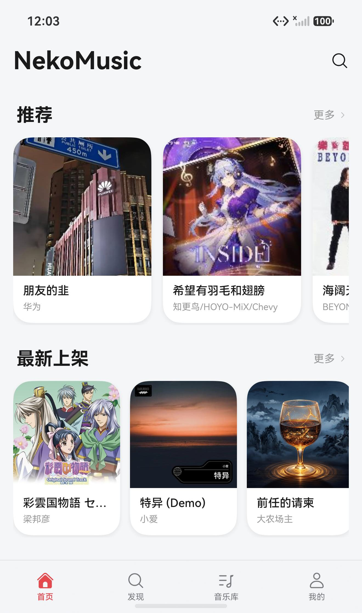
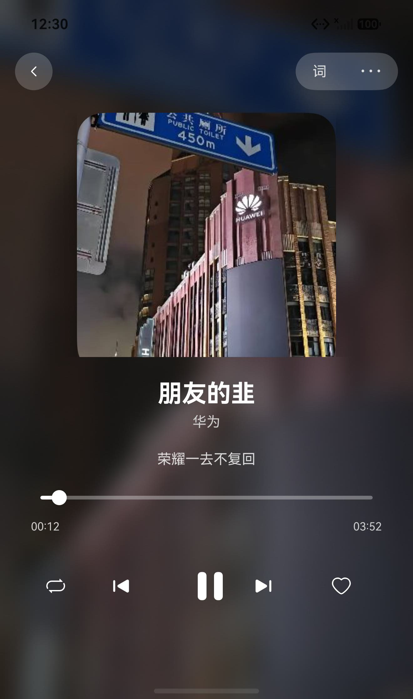
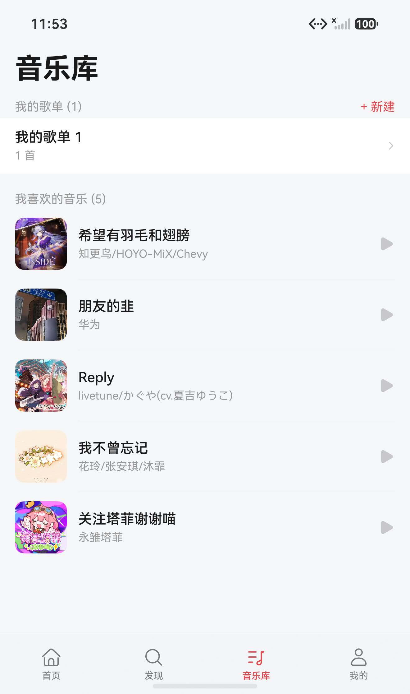
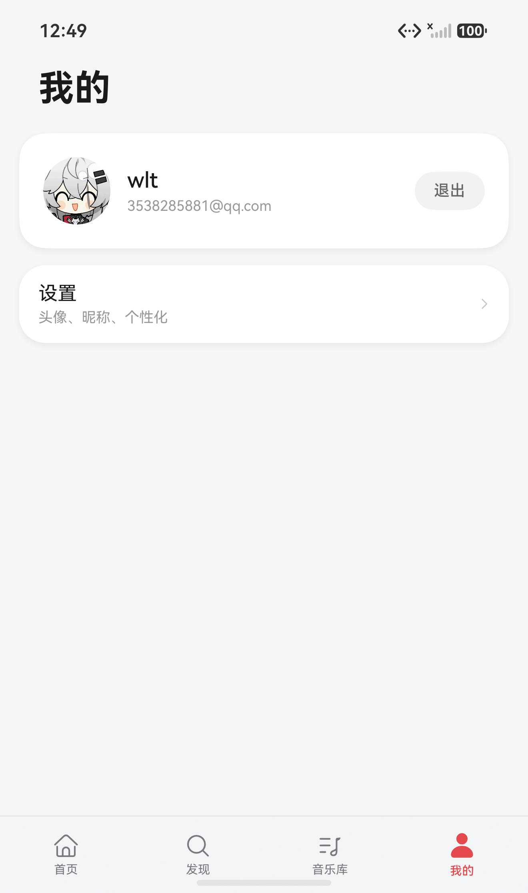
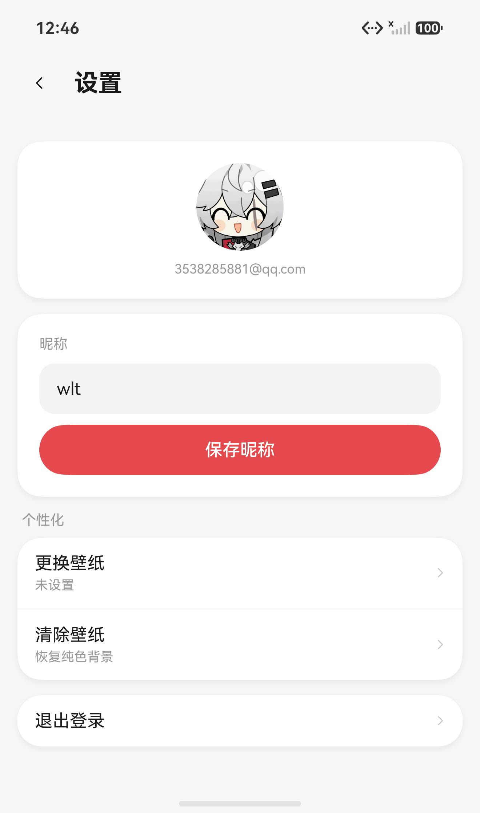
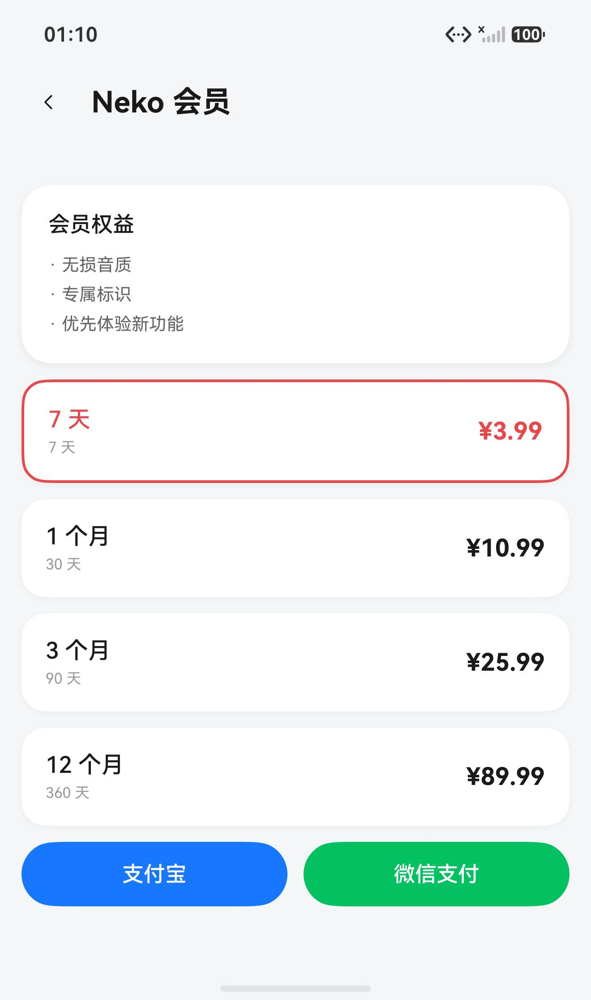

# NekoMusic HarmonyOS



> 为 NekoMusic 准备好你的 HarmonyOS 设备。

NekoMusic 的 HarmonyOS 原生客户端，使用 ArkTS + ArkUI 原生构建，对接 NekoMusic 曲库服务。
不带任何音源，曲库、账号、歌单全部由后端提供；客户端专注于播放、管理和沉浸式听歌体验。

> 当前版本：**V7**（7.0.0）。
>
> 这是鸿蒙端的第一版，功能对齐 iOS 客户端的核心链路。

## 原生，还是原生

**全部使用 ArkTS + ArkUI 原生构建，没有 WebView，没有跨端框架。**

- **沉浸光感材质**：顶栏与悬浮播放条使用系统 `uiMaterial.ImmersiveMaterial`，
  随背景自动磨砂，API 26 以下自动退回半透明样式
- **形态自适应**：通过 `horizontalSizeClass` 与断点布局，手机/折叠屏/平板自适应
- **系统符号**：图标全部使用 `SymbolGlyph` 系统符号，跟随系统主题与动效

## 功能

### 听歌

- 首页推荐 / 最新上架 / 热门排行
- 搜索（歌曲 / 歌手）
- 播放：封面模糊背景、逐行滚动歌词、全屏歌词页（左右滑动切换）
- 底部悬浮播放条：沉浸光感材质、可拖动进度、上一首 / 暂停 / 下一首
- 后台播放与进度同步

### 收藏与歌单

- 收藏 / 取消收藏（红心状态同步）
- 音乐库：收藏列表 + 我的歌单
- 歌单：创建、查看详情、把歌曲加入歌单

### 账号与内容

- 登录 / 退出，token 持久化
- 头像（NekoMusic 账号头像）、昵称修改
- 评论（列表 / 发表）
- 站内消息（未读数、标记已读）
- 上传音乐（ID3 元数据自动填充、语言选择、预览播放、上传进度、我的上传）
- 会员中心（定价、支付宝/微信扫码支付）

### 个性化

- 壁纸（相册选择、模糊处理、持久化）
- 沉浸式状态栏

## 截图

| 首页 | 播放页 | 音乐库 |
|---|---|---|
|  |  |  |

| 我的 | 设置 | 会员 |
|---|---|---|
|  |  |  |

## 构建

需要 DevEco Studio 与 HarmonyOS SDK（API 12+，推荐 23+）。

```bash
export PATH=/Applications/DevEco-Studio.app/Contents/tools/node/bin:$PATH
export DEVECO_SDK_HOME=/Applications/DevEco-Studio.app/Contents/sdk
hvigorw assembleHap --mode module -p product=default --no-daemon
```

产物：`entry/build/default/outputs/default/entry-default-unsigned.hap`

## 侧载安装

```bash
hdc install entry-default-unsigned.hap
```

或用 DevEco Studio 的「Run」直接安装到设备。

## 后端

依赖 [NekoMusic](https://github.com/FantasyNetworkCN/NekoMusic) 后端服务。
鸿蒙端使用官方客户端标识接入：

```
User-Agent:    NekoMusic-harmony/7.0.0
X-Neko-Client: harmony+7.0.0
```

## 致谢

- 后端：[FantasyNetworkCN/NekoMusic](https://github.com/FantasyNetworkCN/NekoMusic)
- iOS 客户端：功能对齐参考
